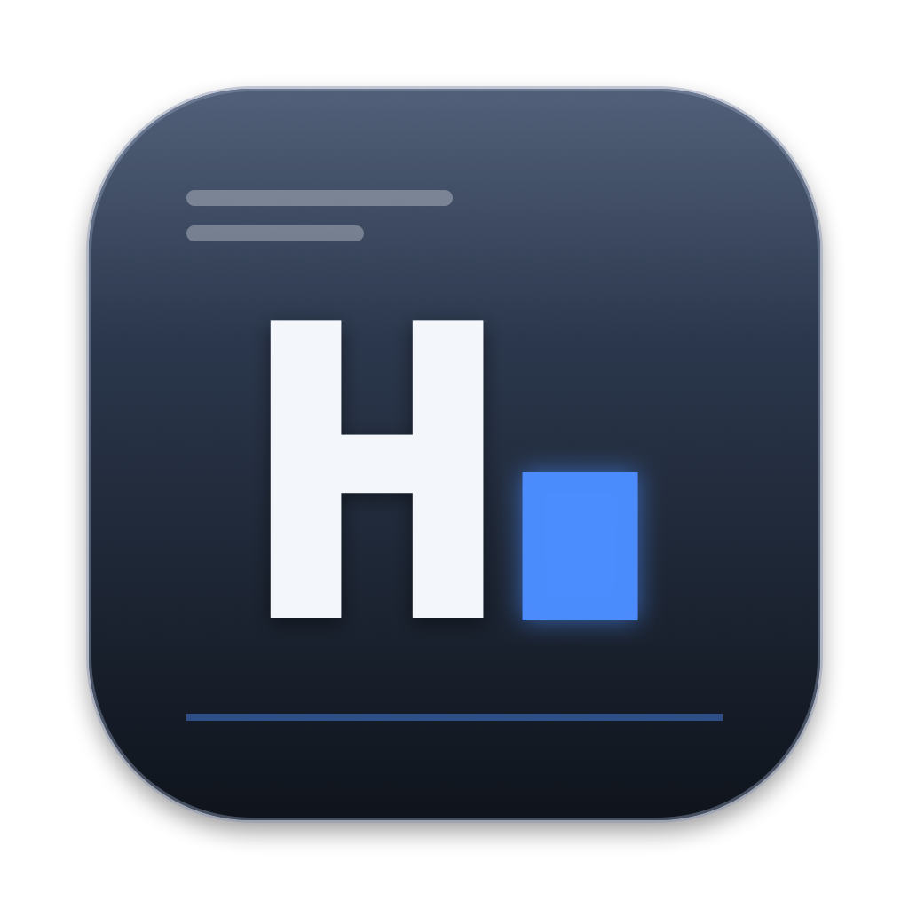
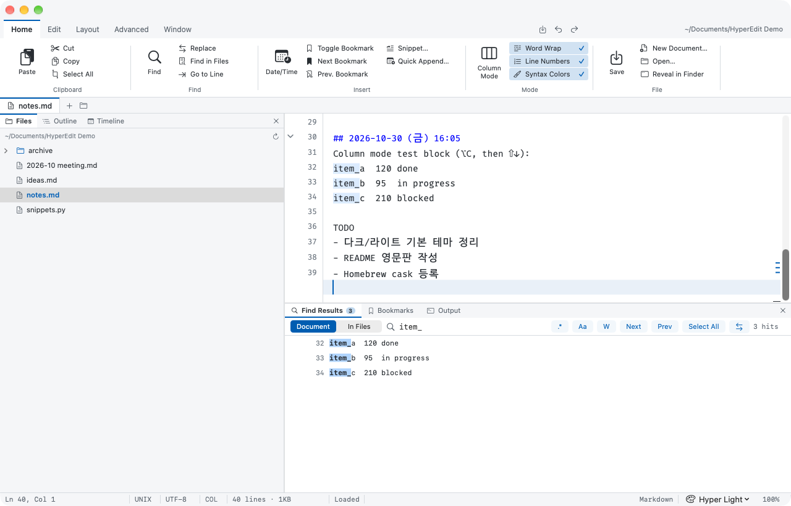
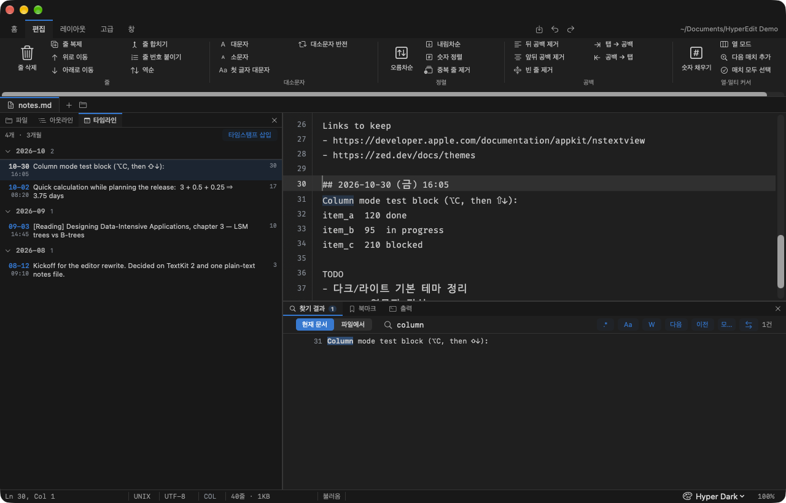

<p align="center"></p>

<h1 align="center">HyperEdit</h1>

<p align="center"><b>계속 길어지는 메모 파일 하나를 위한, 빠른 리본 스타일 macOS 텍스트 에디터.</b></p>

<p align="center">
<a href="https://github.com/Hyeongcheol-An/HyperEdit/releases"></a>
<a href="LICENSE"></a>
<a href="https://github.com/Hyeongcheol-An/HyperEdit/actions/workflows/ci.yml"></a>

</p>

<p align="center"><a href="README.md">English</a> · 한국어 · <a href="docs/guide/USER_GUIDE.zh-Hans.md">简体中文</a> · <a href="docs/guide/USER_GUIDE.ja.md">日本語</a> · <a href="docs/guide/USER_GUIDE.vi.md">Tiếng Việt</a> · <a href="docs/guide/USER_GUIDE.hi.md">हिन्दी</a> · <a href="docs/guide/USER_GUIDE.de.md">Deutsch</a> · <a href="docs/guide/USER_GUIDE.fr.md">Français</a> · <a href="docs/guide/USER_GUIDE.es.md">Español</a> · <a href="docs/guide/USER_GUIDE.pt.md">Português</a> · <a href="docs/guide/USER_GUIDE.ar.md">العربية</a></p>

<p align="center"><a href="docs/guide/USER_GUIDE.ko.md">사용자 가이드</a> — 11개 언어로 제공되는 전체 설명서</p>

HyperEdit는 메모·로그·코드 조각이 수만 줄 쌓인 텍스트 파일 하나를 하루 종일 끝에 덧붙이고 검색하며 쓰는 사람을 위한 에디터입니다. SwiftUI 셸 안에 TextKit 2 기반 AppKit `NSTextView`를 넣어 수 MB 파일도 작은 파일처럼 타이핑되고, 창 구성은 고전적인 리본 에디터의 레이아웃 — 리본 탭, 문서 탭 줄, 사이드바, 하단 패널, 빽빽한 상태바 — 을 따릅니다.

| Hyper Light | Hyper Dark |
|---|---|
|  |  |

## 설치

**요구 사항:** macOS 15 (Sequoia) 이상. 유니버설 바이너리 하나가 Apple Silicon(arm64)과 Intel(x86_64) Mac 에서 네이티브로 실행되며, DMG 이름은 `HyperEdit-x.y.z-universal.dmg` 입니다.

**Homebrew**

```sh
brew tap Hyeongcheol-An/tap
brew install --cask hyperedit
```

Homebrew 7에서는 먼저 tap 을 신뢰하라고 물을 수 있습니다: `brew trust Hyeongcheol-An/tap`.

**DMG**

[GitHub Releases](https://github.com/Hyeongcheol-An/HyperEdit/releases)에서 `HyperEdit-x.y.z-universal.dmg`를 내려받아 열고 `HyperEdit.app`을 `Applications`로 드래그합니다. Developer ID로 서명·공증된 빌드라 Gatekeeper 경고 없이 바로 열립니다. 내려받은 파일을 검증하려면 `SHA256SUMS`를 DMG 옆에 두고 실행하세요.

```sh
shasum -a 256 -c SHA256SUMS
```

### 첫 실행

HyperEdit는 `~/Documents/HyperEdit/notes.md`를 엽니다. 파일이 없으면 짧은 환영 문서로 새로 만듭니다. ⌘N으로 이름과 폴더를 골라 빈 텍스트 파일을 새로 만들 수 있고, ⌘O로 다른 텍스트 파일을 열 수 있으며, 마지막으로 연 파일은 다음 실행 때 기억됩니다. 바이너리 파일(이미지·PDF·압축 파일 등)은 에디터로 불러오지 않고 기본 앱으로 엽니다.

> 인터페이스는 11개 언어 — 영어·한국어·중국어(간체)·일본어·베트남어·힌디어·독일어·프랑스어·스페인어·포르투갈어·아랍어(글은 오른쪽에서 왼쪽, 창 배치는 좌→우 고정) — 로 제공되며 기본은 시스템 언어를 따릅니다. **설정(⌘,) › 언어** 에서 다른 언어를 고르고 **지금 재실행** 을 누르면 바뀌고, 이 선택은 시스템 설정 › 일반 › 언어 및 지역 › 응용 프로그램 과 같은 값을 씁니다. **도움말 › 사용자 가이드** 는 현재 언어의 [사용자 가이드](docs/guide/USER_GUIDE.ko.md)를 엽니다. 번역은 `l10n/ui.<언어>.json` 에 있으며 수정 기여를 환영합니다.

## 기능

### 편집기
- 큰 파일에 맞춘 성능: 1.3 MB / 34,000줄 파일에서 키 입력당 약 3 ms, 뷰포트 기반 TextKit 2 레이아웃. 벤치마크 하네스(`scripts/bench.sh`)가 타이핑·파일 열기·검색·스크롤·메모리·유휴 CPU·실행 시간을 고정 예산과 비교합니다 — [docs/performance.md](docs/performance.md) 참고. v0.6에서는 5,000건 모두 바꾸기의 ⌘Z 한 번을 1.7 s에서 0.25 s로 줄이고, 키 입력마다 일어나던 패널의 SwiftUI 재평가를 없애고, 설치된 폰트 목록을 캐시했습니다.
- 줄 번호 거터, 현재 줄 강조, 자동 줄바꿈(⌥Z), 줄 번호 표시(⌥⌘L), 확대/축소(⌘= / ⌘- / ⌘0).
- 파일별로 마지막 캐럿·스크롤 위치 복원. ⌃⌘E로 문서 끝으로, ⌘L로 줄 이동.
- **접기(⌥⌘← / ⌥⌘→, 모두 접기·펼치기 ⌥⇧⌘← / ⌥⇧⌘→):** 어떤 줄은 그 아래 더 깊이 들여쓴 줄들을 접고(빈 줄 무시), 마크다운 `#` 헤딩은 같거나 높은 레벨의 다음 헤딩 직전까지 접으며(펜스 코드 블록도 접힘), 코드에서 `{`, `[`, `(` 로 끝나는 줄은 닫는 괄호 줄까지 접습니다. 거터의 화살표나 `⋯ N lines` 표식을 클릭해도 접고 펼칩니다. 캐럿이 접힌 줄로 들어가면(찾기, 줄 이동, 북마크, 실행 취소) 자동으로 펼쳐지고, ↑ / ↓ 는 접힌 구간을 건너뜁니다. 접힘은 편집을 따라갑니다 — 머리 줄 안의 입력, 위쪽 줄 삽입·삭제, 실행 취소 — 그리고 세션 동안 유지됩니다.
- **스크롤바 마커:** 편집기 오른쪽 가장자리 12 pt 띠에 검색 매치(강조색 눈금), 북마크(경고색), 캐럿 줄, 접힌 머리 줄을 상대 위치로 표시합니다. 문서가 한 화면에 들어가면 숨겨집니다. 보기 메뉴 → 스크롤바 마커, 또는 레이아웃 탭 패널 그룹.
- F7은 `## 2026-10-30 (금) 14:05` 같은 타임스탬프 헤딩을 삽입합니다. 요일은 시스템 로케일을 따릅니다(영어 환경이면 `(Fri)`).
- **편집기 분할(⌘\\)** — 같은 문서를 두 편집기로 좌우 또는 상하로 나란히 봅니다(보기 › 분할, 레이아웃 탭). 두 뷰는 같은 텍스트와 하나의 undo 스택을 공유하지만(한쪽에서 입력, 다른 쪽에서 ⌘Z) 스크롤은 따로 하고, 명령·상태바·마크다운 미리보기는 마지막으로 클릭한 뷰를 따라갑니다. ⌥⌘\\ 로 다른 분할로 포커스를 옮기며, 켜져 있는 동안 상태바에 **SPLIT**이 표시됩니다.
- **빠른 추가(⇧⌘N, 다른 앱에서는 ⌃⌥N):** HyperEdit를 활성화하지 않는 작은 떠 있는 창입니다. 메모를 쓰고 ⌘↩를 누르면 문서 끝에 덧붙여지고(기본으로 타임스탬프 헤딩 포함) 바로 저장되며 undo 한 번으로 되돌릴 수 있습니다. 창은 숨겨지고 포커스는 쓰던 앱으로 돌아갑니다. Esc로 닫으면 쓰던 글은 다음에 이어집니다. 전역 단축키(끔 / ⌃⌥N / ⌃⌥Space / ⌃⇧Space / ⌃⌥⌘N)는 설정에서 고르며 손쉬운 사용 권한이 필요 없습니다.
- **구문 색(⌃⌘H)** — 파일 확장자로 언어를 고르고 상태바에 표시합니다. 메모·마크다운은 일부러 가벼운 규칙만 — URL, ISO 날짜·시각, `#` 헤딩, `[제목]` 줄, 목록 기호와 `[ ]` / `[x]` 체크박스, `#태그`, `키:` 라벨, `**굵게**`, `` `코드` ``, `⇒ → ->` 화살표 — 를 칠하고, 코드 20여 종(Swift, Python, JavaScript/TypeScript, JSON, 셸, YAML, HTML/XML, CSS, C/C++/Objective-C, Go, Rust, SQL, Ruby, Java/Kotlin, TOML, INI)은 주석·문자열·숫자·키워드·함수·타입 이름을 칠합니다. 색은 테마의 `syntax` 팔레트에서 오고 TextKit 2 렌더링 속성으로 보이는 줄에만 입히므로 파일·undo·타이핑 속도에 영향이 없습니다. 블록 주석(`/* */`, `<!-- -->`), 여러 줄 문자열(Swift·Python 의 `"""`, JavaScript 템플릿 리터럴, Go raw 문자열, Rust `r#"…"#`), 마크다운 펜스 코드 블록은 닫힐 때까지 모든 줄이 색을 유지하고 — 펜스는 정보 문자열의 언어로 칠합니다 — 여는/닫는 기호를 입력하면 아래 줄이 바로 다시 칠해집니다. 줄별 상태 표 덕에 3만 4천 줄 파일도 약 10 ms, 키 입력당 비용은 체감되지 않습니다.
- **사용자 정의 문법:** `~/Library/Application Support/HyperEdit/grammars/` 에 `*.json` 파일을 두면 언어를 추가하거나 내장 언어를 덮어쓸 수 있습니다 — 이름, 확장자·파일 이름, 주석 기호, 문자열 구분자, 키워드 목록. **파일 › 문법 폴더 열기…** 가 `example.json` 과 스키마를 설명하는 README 와 함께 폴더를 만들고, **파일 › 문법 다시 읽기** 로 재실행 없이 반영되며, 상태바에 문법 이름이 보이고 주석 토글(⌘/)도 그 기호를 씁니다.
- **커서 스타일과 창 투명도(설정 › 외형):** 막대·블록·밑줄 캐럿과 깜빡임 끄기 — 멀티 커서·열 모드의 보조 캐럿도 같은 스타일 — 그리고 50–100 % 창 투명도로 편집기·리본·패널·상태바가 반투명해지고(글자는 불투명) 창 뒤 시스템 블러를 켤 수 있습니다. 보기 › 창 투명도 메뉴에 100 / 90 / 80 / 70 % 단계가 있습니다.

### 마크다운 미리보기
- **⇧⌘P**로 편집기를 분할하면 현재 파일을 GFM으로 렌더링한 화면이 오른쪽에 나타납니다(헤딩, 목록과 체크리스트, 표, 코드 블록, 인용, 링크, 이미지). 색은 현재 테마에서 가져오고, 본문은 시스템 글꼴, 코드는 편집기와 같은 고정폭 글꼴을 씁니다.
- 미리보기는 편집기의 스크롤 위치를 따라가고, 입력이 멈추고 300 ms 뒤 다시 렌더링하되 보던 위치를 유지합니다. 링크는 기본 브라우저로 열리고, 원문의 HTML은 실행하지 않고 글자로 보여 주며, 상대 경로 이미지는 파일이 있는 폴더 기준으로 찾습니다. 2 MB가 넘는 파일은 미리보기 대신 안내 문구만 표시합니다.
- 렌더링에는 Apple의 [swift-markdown](https://github.com/swiftlang/swift-markdown)(Apache-2.0)을 씁니다. 미리보기가 켜져 있으면 상태바에 **MD**가 표시됩니다.

### 리본과 패널
- 리본 탭 **홈 / 편집 / 레이아웃 / 고급 / 창**, 새 문서(⌘N)·열기(⌘O) 버튼이 있는 문서 탭 줄, 빠른 실행 저장 / 실행 취소 / 다시 실행.
- **사이드바(⌘1)** — **파일**(현재 파일 폴더의 트리, 한 번 클릭으로 열기), **아웃라인**(⌘3: `##` 헤딩, `[제목]` 줄, `가./나.` 항목, `1)` 번호 항목. 필터 상자와 현재 항목 강조. 코드 주석처럼 보이는 `# …` 줄은 제외), **타임라인**(⌘4: `## YYYY-MM-DD (요일) HH:MM` 타임스탬프 헤딩과 날짜로 시작하는 느슨한 줄을 월별로 묶어 최신순 표시).
- **하단 패널(⌘2)** — **찾기 결과**, **북마크**, **출력** 로그.

### 찾기·바꾸기·북마크
- **찾기(⌘F):** 검색어를 입력하고 Enter를 누르면 모든 매치가 줄 번호와 함께 나열되고, 목록이 열려 있는 동안 편집기 안의 매치도 강조됩니다. 정규식 `.*`, 대소문자 `Aa`, 단어 단위 `W` 토글. F3 / ⇧F3으로 매치 이동, ⌥⌘A로 모든 매치를 멀티 커서로 전환.
- **바꾸기(⌘R):** 현재 매치 바꾸기 / 모두 바꾸기, `$1` 같은 정규식 템플릿 지원. 모두 바꾸기는 ⌘Z 한 번으로 되돌립니다.
- **파일에서 찾기(⇧⌘F):** 폴더를 고르고 `*.md;*.txt` 같은 마스크를 지정합니다. 바이너리 파일은 건너뛰고, 결과를 클릭하면 해당 줄로 엽니다.
- **북마크:** ⌘F2 토글, F2 / ⌥F2 다음 / 이전, 이름은 선택. 북마크는 편집을 따라갑니다 — 위에 줄을 넣거나 지우면 함께 움직이고, 북마크한 줄을 지우면 사라지며, 실행 취소·다시 실행도 따라옵니다. `~/Library/Application Support/HyperEdit/bookmarks/`에 문서별로 저장되므로 문서 옆에는 아무 파일도 만들지 않습니다. 예전 버전이 문서 옆에 만든 `.<파일명>.bookmarks.json` 사이드카는 한 번 읽어 옮깁니다.

### 열 모드와 멀티 커서
- **열 모드(⌥C):** ⌥-드래그 또는 ⇧+방향키로 사각형을 선택하면 입력·삭제가 모든 줄에 적용됩니다. 짧은 줄은 가상 공백으로 채워지고, 복사·붙여넣기는 줄 단위로 동작하며, **숫자 채우기(⌥⌘N)**로 순번을 넣습니다.
- **멀티 커서:** ⌘-클릭으로 커서 추가, ⌘D로 선택과 같은 문자열의 다음 등장 추가, ⌥⌘A로 모든 검색 매치 선택. 모든 멀티 편집은 실행 취소 한 단계입니다.

### 텍스트 도구(편집 탭과 "줄" 메뉴)
줄 삭제 ⇧⌘K · 줄 복제 ⇧⌘D · 위/아래 이동 ⌥↑ / ⌥↓ · 줄 합치기 ⇧⌘J · 역순 · 줄 번호 붙이기 · 오름차순 / 내림차순 / 숫자 정렬 · 중복 줄 제거 · 빈 줄 제거 · 뒤 공백 / 앞뒤 공백 제거 · 탭 → 공백 · 공백 → 탭 · 대문자 / 소문자 / 첫 글자 대문자 / 대소문자 반전.

- **계산(⌃⌘=):** 선택 영역, 없으면 현재 줄(`=`이 있으면 마지막 `=` 뒤)을 계산해 줄 끝에 ` ⇒ 결과`를 붙입니다 — `3+0.5+0.25`는 `3+0.5+0.25 ⇒ 3.75`가 되고, 수식을 고친 뒤 다시 실행하면 옛 결과를 바꿉니다. 산술식만: `+ - * / % ^`, 괄호, `1,234` / `1_000` 숫자, `sqrt abs round floor ceil min max`, `pi`·`e`. 수식이 아니면 출력 패널에 알리고 텍스트는 그대로 둡니다.
- **매크로(⇧⌘M 기록/중지, ⌥⌘M 재생):** 타이핑(한글 IME 는 확정된 글자만), 캐럿 이동·삭제·줄바꿈 명령, 붙여넣기(당시 클립보드 문자열), 위의 텍스트 도구, 다음 찾기(F3, 검색어 포함)를 기록해 캐럿 위치에서 다시 실행합니다. "매크로 여러 번 재생…"은 최대 10,000회 반복하며 찾기 단계가 실패하거나 한 바퀴에 아무 변화가 없으면 스스로 멈추고, 전체 재생은 실행 취소 한 단계입니다. 마지막 기록은 종료할 때까지 메모리에만 두므로(기록 중 친 비밀번호가 디스크에 남지 않습니다) "마지막 매크로 이름 붙여 저장…"으로 매크로 메뉴에 등록해야 유지되며, 저장된 목록은 `~/Library/Application Support/HyperEdit/macros/macros.json`에 있고 "매크로 파일 편집…"으로 편집기에서 엽니다. 마우스 클릭, 선택 변경, 멀티 커서 편집(모두 바꾸기, 숫자 채우기)은 기록되지 않습니다. 기록 중에는 상태바에 `● REC`가 표시됩니다.
- **열 맞춤(⌃⌘T):** 탭으로 구분된 열(선택한 줄, 없으면 캐럿 주변의 탭 줄 묶음)을 공백으로 채워 모든 열이 같은 표시 열에서 시작하게 합니다. 한글·CJK는 두 칸으로 셉니다. 줄마다 `|`가 있으면 마크다운 표로 보고 ` | ` 안을 채우며, `---` 줄은 다시 그리고 `--:` 열은 오른쪽 정렬합니다.
- **주석 토글(⌘/):** 선택한 줄(없으면 현재 줄)에 파일 종류의 주석 기호를 넣거나 뺍니다 — 코드는 `//`, `#`, `--` 등, 마크다운과 HTML/XML은 `<!-- -->`, CSS는 `/* */`, 일반 메모는 `//`. VS Code 방식으로, 비어 있지 않은 줄이 전부 주석이면 모두 해제하고 아니면 모두 주석 처리하며, 기호는 가장 얕은 들여쓰기에 맞춰 세로로 정렬됩니다. 빈 줄은 건너뛰고 탭은 탭 그대로 둡니다.
- **JSON 정리(⌃⌘J) / JSON 한 줄로:** 선택 영역(없으면 문서 전체)을 들여쓰기 2칸으로 정리하거나 한 줄로 줄입니다. 키 순서와 숫자 표기(`1.0`, 큰 정수)는 그대로 두고 문자열은 최소한으로 다시 이스케이프합니다(한글·이모지는 그대로). 입력은 BOM, 뒤따르는 쉼표, `//` / `/* */` 주석(JSONC)을 받아 주고 출력은 항상 엄격한 JSON입니다. 문법 오류가 있으면 텍스트는 두고 출력 패널에 `줄:열`을 알린 뒤 캐럿을 그 자리로 옮깁니다. 5.6 MB 문서도 약 30 ms에 정리됩니다.
- **스니펫:** `todo`, `date`, `time`, `now`, `meeting`, `table`, `link`, `code` 같은 트리거를 치고 Tab을 누르거나 **스니펫 삽입…(⇧⌘I)**에서 고릅니다. 본문에는 `${date}`, `${time}`, `${datetime}`, `${selection}`, `${clipboard}`, `${filename}` 변수와 탭스톱 `$1` … `$9`, `${1:자리표시자}`, `$0`을 쓸 수 있고, Tab / ⇧Tab으로 탭스톱을 오가며(같은 번호를 두 번 쓰면 멀티 커서), Esc나 클릭으로 끝냅니다. **스니펫 편집…**은 `~/Library/Application Support/HyperEdit/snippets.json`을 HyperEdit 자신으로 열며, 저장하면 다시 읽습니다.

### 저장
- 입력이 멈추고 2초 뒤 자동 저장. 종료·창 닫기·파일 전환 시에는 동기로 저장하므로 2초 사이의 편집이 사라지지 않습니다. 모든 쓰기는 원자적입니다.
- 세션마다 첫 저장 전에 스냅샷 사본을 `~/Library/Application Support/HyperEdit/snapshots`에 남깁니다. 파일별로 최신 20개를 유지하고 90일이 지난 것은 지웁니다.
- 외부 변경을 감지합니다. 버퍼가 깨끗하면 다시 읽고(캐럿 위치는 유지), 수정 중이면 외부본을 스냅샷으로 보관한 뒤 경고합니다.
- 빈 버퍼를 내용이 있는 파일 위에 덮어쓰지 않습니다.
- 인코딩은 UTF-8 → EUC-KR(CP949) → CP1252 → Latin-1 순으로 손실 없이 판별해 상태바에 표시하고, 저장할 때도 같은 인코딩을 씁니다(UTF-8 BOM 보존). 원 인코딩으로 표현할 수 없는 문자를 입력하면 UTF-8로 저장하고 상태바에 알립니다. 어느 인코딩으로도 읽을 수 없는 파일은 망가뜨리지 않도록 아예 열지 않습니다.
- 상태바에 Ln / Col(선택 중이면 선택 길이, 문자 오프셋은 툴팁), 줄바꿈 종류(UNIX / DOS / MAC), 파일 인코딩, COL 표시, 커서 수, 줄 수 · 크기, 상태 메시지, 구문 언어(구문 색이 꺼져 있으면 흐리게), 테마 선택(시스템 따르기 중이면 "· 시스템" 표시), 확대 비율이 표시됩니다.

### 내보내기(HTML / PDF)
- **파일 › HTML로 내보내기…** 는 문서를 독립된 HTML 파일 하나로 저장하고, **파일 › PDF로 내보내기…** 는 같은 페이지를 쪽이 나뉘는 PDF 로 찍습니다. 저장 패널은 문서 폴더에서 열리며 **테마**(현재·Hyper Light·Hyper Dark)와, 메모·코드용 **줄 번호** 옵션이 있습니다.
- 마크다운은 미리보기와 똑같이 렌더링되고(제목·목록·체크리스트·표·코드 블록·인용·링크·이미지) 테마가 CSS 로 인라인됩니다. 원문 HTML 은 글자로만 남고 스크립트·외부 리소스는 없습니다. 메모·코드는 여러 줄 주석·문자열까지 구문 색을 입힌 `<pre>` 블록이 됩니다.
- PDF 용지는 미국·캐나다·멕시코면 Letter, 그 밖에는 A4, 여백 36 pt, 머리글·바닥글 없음. 제목은 아래 본문과 떨어지지 않고 표·코드 블록은 한 쪽에 들어가면 나누지 않습니다. PDF 는 미리보기처럼 2 MB 까지. 출력 패널과 상태바에 `HTML 내보내기 완료 · ~/경로` 또는 오류가 표시됩니다.

### 비밀 블록
- 정보 문자열이 `secret` 로 시작하는 펜스 코드 블록(```` ```secret ````, ```` ```secret 은행 ````)은 **비밀 블록** 입니다. 편집기에서 안쪽 줄은 가림막과 `••••••••` 로 그려지고 펜스 줄은 보이므로, 비밀번호·키·토큰을 메모에 두되 화면에는 보이지 않게 할 수 있습니다. 캐럿을 블록에 넣으면(클릭, ↑ / ↓, 줄 이동, 찾기 결과, 북마크) 드러나 편집할 수 있고 나가면 다시 가려집니다. 텍스트는 그대로라 찾기·바꾸기·undo·저장이 평소와 같고, 가리는 것일 뿐 암호화가 아닙니다 — 파일과 스냅샷은 평문입니다.
- **비밀 드러내기(⌥⌘S)** 는 모든 블록을 드러냈다가 설정 › 비밀 › *다시 가리기까지*(10 / 30 / 60초 또는 안 함) 뒤 다시 가립니다. 그동안 상태바에 `REVEALED`, 가린 동안에는 `•••• N` 이 표시됩니다. 찾기 결과·아웃라인·타임라인·마크다운 미리보기·HTML/PDF 내보내기는 비밀 줄을 `••••••••` 로 보여 줍니다.
- **클립보드 자동 비우기:** 비밀 줄과 겹치는 복사·잘라내기 뒤 10 / 30 / 60초(기본 30초)가 지나면 그 사이 다른 것을 복사하지 않았을 때 클립보드를 비웁니다. **편집 › 클립보드 비우기** 는 즉시 비웁니다.

### 앱 잠금 (Touch ID)
- **HyperEdit › HyperEdit 잠금(⌃⌘L)** 은 리본·사이드바·편집기·패널·상태바까지 창 전체를 현재 테마 색의 불투명한 잠금 화면으로 가리고, 열려 있던 설정 창을 닫고 빠른 추가 패널을 숨깁니다. 잠긴 동안에는 파일 이름을 포함해 문서에 관한 어떤 것도 보이지 않습니다. **잠금 해제**(또는 Return)는 **Touch ID** 로 인증하고, Touch ID 가 실패하거나 없는 Mac 에서는 로그인 암호로 대신합니다. 취소하면 잠긴 채 유지됩니다.
- **설정 › 앱 잠금:** *HyperEdit 를 열 때 Touch ID 또는 암호 요구*(기본 꺼짐)를 켜면 앱이 잠긴 상태로 시작합니다 — 문서는 읽히고 자동 저장도 계속되지만 인증 전에는 아무것도 보이지 않습니다. *입력이 없으면 잠금*(안 함 / 1 / 5 / 15 / 30분)은 HyperEdit 안에서 키 입력이나 클릭이 그 시간 동안 없으면 잠그고, *Mac 이 잠자기에 들어가거나 화면이 잠기면 잠금*(기본 켜짐)은 시작 옵션이 켜져 있을 때 적용됩니다.
- 잠긴 동안 키 입력은 버려지고 메뉴 막대는 열리지 않습니다(⌘Q, ⌘H / ⌥⌘H, ⌘M, ⌘W, ⌃⌘F 와 Dock 메뉴만 동작). 빠른 추가 전역 단축키는 패널 대신 잠금 해제 프롬프트를 띄웁니다. 화면을 가리는 프라이버시 잠금이지 암호화가 아니며 디스크의 파일은 그대로입니다. Touch ID 도 로그인 암호도 없는 Mac 에서는 *요구…* 옵션이 켜지지 않으므로 스스로 잠겨 버리는 일은 없습니다.

## 단축키

| 단축키 | 동작 | 단축키 | 동작 |
|---|---|---|---|
| ⌘N | 새 문서 | ⌘O | 열기 |
| ⌘S | 저장 | ⌘F | 찾기 |
| ⌘R | 바꾸기 | ⇧⌘F | 파일에서 찾기 |
| F3 / ⇧F3 | 다음 / 이전 매치 | ⌘L | 줄로 이동 |
| ⌃⌘E | 문서 끝으로 | ⌥C | 열 모드 |
| ⌘D | 다음 매치 추가 | ⌥⌘A | 매치 모두 선택 |
| ⌥⌘N | 숫자 채우기 | F7 | 타임스탬프 삽입 |
| ⌘F2 | 북마크 토글 | F2 / ⌥F2 | 다음 / 이전 북마크 |
| ⇧⌘K | 줄 삭제 | ⇧⌘D | 줄 복제 |
| ⌥↑ / ⌥↓ | 줄 위 / 아래로 이동 | ⇧⌘J | 줄 합치기 |
| ⌃⌘= | 계산(⇒ 결과 붙이기) | ⌃⌘T | 열 맞춤 |
| ⌘/ | 주석 토글 | ⌃⌘J | JSON 정리 |
| ⇧⌘I | 스니펫 삽입 | Tab | 스니펫 트리거 펼침 / 다음 탭스톱 |
| ⌘1 | 사이드바 | ⌘2 | 하단 패널 |
| ⌘3 | 아웃라인 | ⌘4 | 타임라인 |
| ⌥⌘L | 줄 번호 | ⌥Z | 자동 줄바꿈 |
| ⌥⌘] / ⌥⌘[ | 다음 / 이전 테마 | ⌘= / ⌘- / ⌘0 | 확대 / 축소 / 기본 |
| ⌘, | 설정 | ⇧⌘P | 마크다운 미리보기 |
| ⌃⌘H | 구문 색 | ⌘\\ | 편집기 분할 |
| ⌥⌘\\ | 다른 분할로 포커스 | ⇧⌘N | 빠른 추가 |
| ⌃⌥N | 다른 앱에서 빠른 추가(전역, 설정 가능) | ⇧⌘M | 매크로 기록 / 중지 |
| ⌥⌘M | 매크로 재생 | ⌥⌘← / ⌥⌘→ | 접기 / 펼치기 |
| ⌥⇧⌘← / ⌥⇧⌘→ | 모두 접기 / 모두 펼치기 | ⌥⌘S | 비밀 블록 드러내기 / 가리기 |
| ⌃⌘L | HyperEdit 잠금(Touch ID) | | |

## 테마

22개 팔레트가 [`themes/palettes.json`](themes/palettes.json) 한 곳에 정의되어 앱 테마와 [Zed](https://zed.dev) 테마를 함께 만듭니다. 기본값은 시스템 외형 따르기 — 라이트 모드면 **Hyper Light**, 다크 모드면 **Hyper Dark** 입니다. 테마를 직접 고르면(레이아웃 탭, 상태바 메뉴, 보기 메뉴, ⌥⌘] / ⌥⌘[) 그 테마로 고정되고, 같은 세 메뉴와 설정(⌘,)에서 "시스템 외형 따르기"를 다시 켤 수 있습니다.

| 라이트 (5) | 다크 (17) |
|---|---|
| Hyper Light · Hyper Gruvbox Light · Hyper Solarized Light · Hyper Catppuccin Latte · Hyper GitHub Light | Hyper Dark · Hyper Homebrew Terminal · Hyper Green Blue Contrast · Hyper Xcode High Contrast Dark · Hyper One Dark · Hyper Dracula · Hyper Gruvbox Dark · Hyper Solarized Dark · Hyper Nord · Hyper Catppuccin Mocha · Hyper Tokyo Night · Hyper GitHub Dark · Hyper Monokai · Hyper Night Owl · Hyper Rosé Pine · Hyper Everforest Dark · Hyper Ayu Mirage |

전체 미리보기는 [`docs/theme-preview.html`](docs/theme-preview.html)에 있습니다. **Zed:** 같은 팔레트가 `themes/dist/hyperedit-themes.json`으로 내보내지며 모든 릴리스에도 첨부됩니다. `python3 themes/build_zed_theme.py --install`로 설치한 뒤 ⌘K ⌘T에서 `Hyper …` 테마를 고르세요. 자세한 내용은 [docs/zed.md](docs/zed.md).

## 폰트와 한글

HyperEdit는 **Fira Code**가 설치되어 있으면 그것을, 없으면 시스템 고정폭 폰트를 씁니다. 한글은 별도의 폴백 폰트 — 설치되어 있으면 기본 **D2Coding** — 로 ×1.2 배율로 그려, 한글 한 글자가 정확히 영문 두 칸 폭이 되게 합니다. 덕분에 탭으로 맞춘 표가 어긋나지 않습니다. 리거처, 줄 높이, 두 폰트 패밀리, 한글 배율은 모두 설정(⌘,)에 있습니다. 자세한 내용과 대안: [docs/fonts.md](docs/fonts.md).

## 소스에서 빌드

macOS 15의 Xcode 16 이상과 [XcodeGen](https://github.com/yonaskolb/XcodeGen)이 필요합니다.

```sh
brew install xcodegen
scripts/bootstrap.sh                                   # HyperEdit.xcodeproj 생성 (git 제외)
scripts/build-mac.sh --run                             # Release 빌드 후 실행 (첫 빌드는 swift-markdown 을 내려받음)
scripts/build-mac.sh Debug --run --file path/to/file   # Debug 는 큰 파일에서 눈에 띄게 느림
swift test --package-path Packages/HyperCore           # 엔진 단위 테스트
scripts/install-mac.sh --open                          # ~/Applications 에 설치
scripts/make-dmg.sh                                    # DMG (+ 자격 증명이 있으면 서명·공증·스테이플)
```

서명 기본값은 Xcode의 "Sign to Run Locally"라 Apple 팀 없이도 빌드·실행할 수 있습니다. 본인 팀으로 서명하려면 `Config/Local.xcconfig.example`을 `Config/Local.xcconfig`(git 제외)로 복사해 팀 ID를 채우세요. `scripts/make-dmg.sh`는 Developer ID 인증서와 공증 자격 증명이 있으면 자동으로 서명·공증하며, `scripts/setup-signing.sh`가 그 설정을 도와줍니다.

### 개발용 실행 인자

스크린샷·자동화·디버깅에 씁니다. `open -n HyperEdit.app --args …` 또는 `scripts/build-mac.sh --run …` 뒤에 붙입니다.

| 인자 | 효과 |
|---|---|
| `--file <path>` | 기억된 파일 대신 이 파일을 연다 |
| `--snapshot <png> [--snapshot-delay s] [--snapshot-activate] [--quit]` · `--snapshot-panel <png>` · `--window-width <pt>` | ScreenCaptureKit으로 창을 PNG로 캡처(화면 녹화 권한 필요). `--snapshot-panel`은 `--quick-append`로 띄운 빠른 추가 창을 따로 찍는다. 스냅샷 실행은 폭을 주지 않으면 1280 pt 창을 쓴다 |
| `--selftest [--selftest-out <txt>] [--quit]` · `--selftest-split-big <file>` · `--show-snippet-picker` · `--show-macro-recording` · `--snapshot-sheet <png>` | 임시 파일에서 내장 셀프테스트(393개 검사) 실행. 사용자 문서는 건드리지 않음. `--selftest-split-big`은 지정한 파일에 입력했다가 되돌리며 분할 편집기 타이핑 지연을 재는 검사를 추가한다(사본에서만). `--show-snippet-picker`는 스크린샷용으로 스니펫 삽입 창을 띄운 채 둔다. `--selftest-open`은 가리킨 파일을 수정하는 파일 전환 벤치 — 사본에서만 |
| `--theme <id>` · `--follow-system-theme` | `palettes.json`의 팔레트 id로 시작, 예: `hyper-dark` / 시스템 외형 따르기로 시작 |
| `--ribbon <home\|edit\|layout\|advanced\|window>` | 리본 탭 선택 |
| `--left <files\|outline\|timeline>` · `--bottom <find\|bookmarks\|output>` · `--hide-left` · `--hide-bottom` | 사이드바 / 하단 패널 탭 표시, 또는 사이드바 / 하단 패널 숨기기 |
| `--search <text>` · `--replace [--replace-with <text>]` · `--find-in-files` | 찾기 창 미리 채우기 |
| `--column` · `--goto <line>` · `--preview` | 열 모드 켜기 / 줄로 이동 / 마크다운 미리보기 표시 |
| `--show-settings` · `--snapshot-settings <png>` | 실행 뒤 설정 창 열기 / (`--snapshot` 과 함께) 설정 창을 PNG 로 캡처 — 언어별 스크린샷용 |
| `--split [vertical\|horizontal]` · `--quick-append` | 편집기를 분할한 채 시작(기본 좌우) / 빠른 추가 창 열기 |
| `--no-highlight` | 구문 색을 끈 채 시작 (스크린샷 비교용) |
| `--fold <line>` · `--fold-all` · `--no-fold` | 해당 줄이 머리인 영역 접기 / 영역 스캔 뒤 모두 접기 / 접기 기능 끄기 |
| `--cursor <bar\|block\|underline>` · `--no-cursor-blink` · `--opacity <0.5~1.0>` · `--blur` | 그 캐럿 스타일 / 깜빡임 끄고 / 그 창 투명도 / 반투명 창 뒤 블러로 시작 |
| `--reveal-secrets` | 모든 비밀 블록을 드러낸 상태로 시작(자동 재마스킹 없음) |
| `--locked` | 잠긴 상태로 시작(스크린샷용). 실제 인증기를 쓰므로 잠금 해제 버튼을 누르기 전에는 프롬프트가 뜨지 않으며, 자동화 실행은 이 인자 없이는 잠긴 채 시작하지 않음 |
| `--ephemeral` | 이번 실행만 휘발성 설정(테마·패널·마지막 파일·스니펫·매크로·문법)을 쓴다 — 수동 테스트용 |
| `--debug-perf [--debug-perf-log <path>]` | 구간 시간과 120 ms 이상 메인 스레드 정지 기록 |
| `--debug-startup [--debug-startup-log <file>]` · `--debug-preview-log <file>` · `--debug-no-apply` | 진단용: 실행 중 창 생성 과정을 stderr(와 파일)에 기록 / 마크다운 미리보기 렌더·탐색 기록 / 테마·폰트 속성 적용 생략 |
| `--bench [--bench-out <json>] [--bench-strict] [--bench-only <phases>] [--bench-commit <sha>] [--quit]` | 생성한 말뭉치(2 KB~8 MB)로 성능 벤치마크. 예산별 PASS/FAIL 이 있는 JSON + Markdown 을 쓴다 — [docs/performance.md](docs/performance.md) 참고. 단계: `idle open memory scroll search outline theme typing replace save`. `scripts/bench.sh` 가 감싸서 실행 |
| `--quit-after-launch [--bench-launch-log <file>]` | 첫 창이 뜨고 약 0.1 s 뒤 종료하며 실행 이정표(프로세스 시작 → 창)를 로그에 덧붙인다 |

## 저장소 구성

```
Apps/mac/            SwiftUI 셸: 리본, 패널, 설정, 메뉴(HyperEditApp.swift, MacroUI.swift, SecretsUI.swift, GrammarUI.swift, Appearance.swift), Export/, AppLock/, Bench.swift, SelfTest*.swift
  Editor/            AppKit 편집기: HyperTextView(TextKit 2), GutterView, EditorSession(분할), FoldController, ScrollMarkerView, SnippetSession, MacroRecorder
  QuickAppend/       비활성화 NSPanel, 컨트롤러, Carbon 전역 단축키
  Panels/ Markdown/  사이드바·하단 패널, SnippetPickerView · WKWebView 마크다운 미리보기
Packages/HyperCore/  엔진(문서, 줄 인덱스, 검색, 텍스트 도구, 주석 토글, JSON 정리, 스니펫, 매크로 모델, 빠른 추가 조합, 열 블록 수학, 아웃라인/타임라인, 접기 스캐너, 테마, 폰트, 마크다운 → HTML) + 단위 테스트 137개
themes/              palettes.json(단일 소스), build_zed_theme.py, build_preview.py, validate.py, dist/
docs/                features.md · performance.md · fonts.md · zed.md · design.ko.md · theme-preview.html · bench/(기준선 JSON) · release-notes/ · screenshots/ · sample/
l10n/                ui.<언어>.json — 언어별 평면 사전(scripts/l10n-export.py 로 내보내고 scripts/l10n-add.py 로 카탈로그에 병합) · context.json
scripts/             bootstrap · build-mac · install-mac · make-dmg · bench · make-icon.swift · set-version · setup-signing · update-cask · check-sensitive · check-l10n · l10n-export · l10n-add · install-hooks
Config/              Version.xcconfig(semantic-release 가 관리) · Signing.xcconfig 기본값 · Local.xcconfig.example
.github/workflows/   ci.yml(테마, 민감 정보 검사, commitlint, macOS 빌드+테스트) · release.yml(semantic-release → DMG → GitHub Release → Homebrew cask)
```

`HyperCore`는 플랫폼 중립(macOS 15 / iOS 18 타깃 선언)이지만, 현재는 macOS 앱만 있습니다.

## 릴리스 과정

커밋은 [Conventional Commits](https://www.conventionalcommits.org/ko/)를 따르고, 제목은 semantic-release 가 릴리스 노트로 쓰므로 영어로 적습니다(본문은 한국어 가능). `main`에 push될 때마다 [semantic-release](https://semantic-release.gitbook.io)가 커밋으로 다음 버전을 계산하고 `CHANGELOG.md`·`VERSION`·`Config/Version.xcconfig`를 갱신한 뒤, DMG를 빌드·서명·공증하고, `SHA256SUMS`와 Zed 테마 파일을 첨부한 GitHub Release를 만들고, `Hyeongcheol-An/homebrew-tap`의 Homebrew cask를 갱신합니다. `feat:` → 마이너, `fix:` / `perf:` → 패치, `docs:` / `chore:` / `refactor:` → 릴리스 없음. 워크플로는 Developer ID·공증 시크릿이 없으면 릴리스를 만들지 않습니다(포크는 저장소 변수 `ALLOW_UNSIGNED_RELEASE=true`로 서명 없는 빌드를 허용할 수 있습니다). Release 빌드는 심볼과 미사용 코드를 제거하며(`project.yml`의 `DEAD_CODE_STRIPPING`, `STRIP_INSTALLED_PRODUCT`, `STRIP_STYLE: all`), v0.6에서 유니버설 바이너리가 13.5 MB에서 6.5 MB로 줄었습니다. 로컬 커밋 메시지 훅은 `scripts/install-hooks.sh`로 설치합니다.

## 로드맵과 제한

- 인터페이스는 11개 언어로 번역돼 있고, 그 밖의 시스템 언어(예: 중국어 번체)는 영어로 표시됩니다. 언어를 바꾸려면 재실행이 필요한데, 설정의 버튼이 대신 해 줍니다.
- 구문 색은 블록 주석·여러 줄 문자열·마크다운 펜스를 줄 너머로 추적하지만, 여는/닫는 구분자가 같은 문자열과 언어당 블록 주석 1쌍만 지원하고 사용자 문법은 단어 목록 기반입니다(정규식 규칙 없음). 마크다운 미리보기(⇧⌘P)는 현재 파일을 렌더링해 보여 주는 보기 전용 화면입니다.
- 로컬 파일만 다룹니다. 클라우드 동기화 없음. 엔진은 iOS를 염두에 두고 만들었지만 iOS 앱은 아직 없습니다.
- 매크로는 키보드 편집만 기록합니다(마우스·선택·멀티 커서 단계 없음). 즉석 계산과 열 맞춤은 산술식과 탭 / 파이프 표에만 동작합니다(변수·단위·날짜 계산 없음). 주석 토글은 줄 단위이고(블록 주석 선택 없음), JSON 정리에는 정렬·스키마 기능이 없습니다.
- 스니펫·매크로·사용자 문법은 JSON 파일(Application Support의 `snippets.json`, `macros/macros.json`, `grammars/*.json`)로 편집합니다. GUI 편집기는 없습니다.
- 내보내기는 문서 전체만(선택 영역·여러 파일·용지·글꼴 옵션·PDF 목차 없음). 비밀 블록은 화면에서만 가리며 파일·자동 저장·스냅샷·다른 파일의 파일에서 찾기 결과는 평문이고, 가림막 길이로 줄 길이는 보입니다. 앱 잠금은 창을 가리고 입력을 막을 뿐 파일을 암호화하지 않으며, 잠글 때 떠 있던 시트는 잠금 화면 위에 남습니다(문서는 보이지 않음).
- 접기는 세션 동안만 유지되고(파일별로 저장하지 않음), 접힌 머리 줄을 지나는 마우스 드래그 선택에는 숨은 텍스트가 포함됩니다.
- 빠른 추가의 전역 단축키는 시스템 핫키 API를 쓰므로, 시스템 설정 › 키보드에서 입력 소스 전환이 켜져 있으면 ⌃Space / ⌃⌥Space 변형은 아무 알림 없이 시스템에 밀립니다. 대신 ⌃⌥N 이나 ⌃⌥⌘N 을 고르세요.

설계 메모와 결정 이력은 [docs/design.ko.md](docs/design.ko.md)에, 상태가 표시된 기능 목록은 [docs/features.md](docs/features.md)에 있습니다.

## 기여와 보안

버그 신고와 아이디어는 [GitHub Issues](https://github.com/Hyeongcheol-An/HyperEdit/issues)와 [Discussions](https://github.com/Hyeongcheol-An/HyperEdit/discussions)로 보내 주세요. 개발 환경, 커밋 규약, PR 체크리스트는 [CONTRIBUTING.md](CONTRIBUTING.md)에, 취약점을 비공개로 신고하는 방법은 [SECURITY.md](SECURITY.md)에 있습니다. 이 프로젝트는 [Contributor Covenant](CODE_OF_CONDUCT.md)를 따릅니다.

## 상표 고지

HyperEdit의 레이아웃은 고전 UltraEdit 리본에서 영감을 받았습니다. UltraEdit는 IDM Computer Solutions, Inc.의 상표이며, HyperEdit는 IDM과 무관한 독립 오픈소스 프로젝트로 IDM의 보증을 받지 않았습니다.

## 라이선스

[MIT](LICENSE) © 2026 Hyeongcheol An

마크다운 미리보기는 [swift-markdown](https://github.com/swiftlang/swift-markdown)과 그 의존성 [swift-cmark](https://github.com/swiftlang/swift-cmark)(cmark-gfm)로 만들었습니다. 둘 다 © Apple Inc. 및 기여자, [Apache License 2.0](https://github.com/swiftlang/swift-markdown/blob/main/LICENSE.txt)이며, 빌드 시 Swift Package Manager가 내려받아 앱에 링크합니다.
